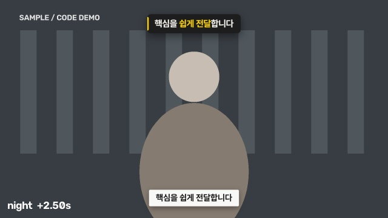
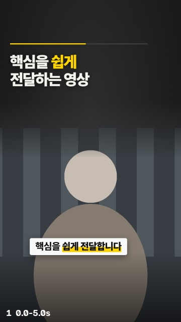
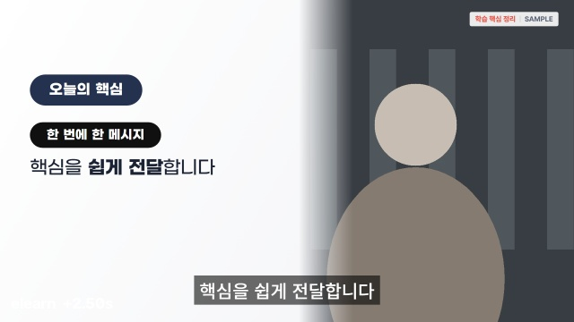
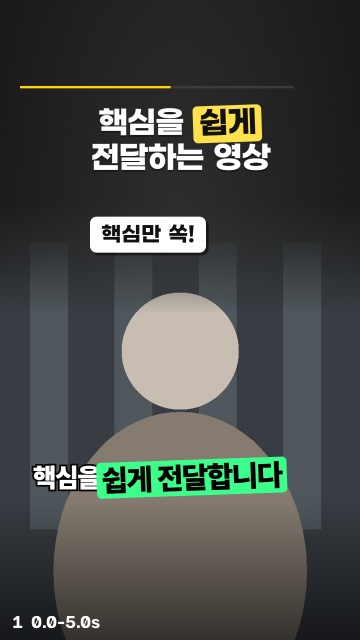

# AI에게 말로 맡겨 30초 영상 만들기

아래 요청문을 **한 단계씩 복사해서 보내면 됩니다.** 에이전트의 결과를 보고, 마음에 드는 것을 고르고, 고쳐 달라고 말합니다. 코드는 쓰지 않습니다.

**대표 양식 이미지 보기 → 양식 선택 → 원본 보기·선택 → 편집안 → 미리보기 → 영상 제작 → 수정**

2인 1조 · 25분. 한 명은 요청문을 보내고, 다른 한 명은 이미지와 결과를 보며 의견을 냅니다. 가로 양식도 빠르게 실습할 수 있도록 결과는 30초 이내로 만듭니다.

## 0. 실습 전 준비 — 이 요청부터 보내기

### 받을 것은 두 가지입니다

1. **에이전트·스킬·편집 도구:** [실습 GitHub](https://github.com/dohyeon9483/handson-shorts-agent) → 초록색 **Code → Download ZIP** → 압축 풀기. Git 명령어나 별도 스킬 설치는 필요 없습니다.
2. **실습 샘플:** 노션에서 `노션배포_실습샘플_원본3종.zip`을 받습니다. 각 원본의 **MP4 + VTT + words.json**이 들어 있습니다. words.json은 미리 STT로 만든 낱말 시각으로, 실습 중 받아쓰기 없이 낱말 강조를 사용할 수 있게 해 줍니다. 압축 해제와 작업 폴더로 복사는 에이전트에게 맡겨도 됩니다. 본인 가로 영상을 써도 됩니다.

Claude Code 또는 Codex에서 GitHub ZIP을 푼 폴더 중 **README.md와 AGENTS.md가 함께 보이는 폴더**를 엽니다. 다른 폴더를 열면 내려받은 지침과 스킬을 찾지 못할 수 있습니다.

**세미나 전 보낼 프롬프트**

> 실습 준비를 해 줘. 이 GitHub 프로젝트의 AGENTS.md와 연결된 스킬을 먼저 읽어 줘. 다운로드 폴더의 ‘노션배포_실습샘플_원본3종.zip’을 찾아 원본을 보존하면서 media 폴더에 준비해 줘. 필요한 패키지와 브라우저를 설치하고 환경 점검과 대표 양식 4종 미리보기 시험을 해 줘. 샘플 영상과 함께 제공된 VTT와 words.json의 파일명·시각 범위를 확인해 줘. 실습 샘플은 STT를 다시 돌리지 말고 이 파일을 사용해 줘. 대표 화면과 받아쓰기를 읽고 원본별 장면 지도도 work 폴더에 작성해 줘. 이름이나 제품명 표기가 불확실하면 임의로 바꾸지 말고 알려 줘. 최종 영상은 아직 만들지 마.

**받을 결과:** 환경 점검, 원본 세 종류의 대표 화면·받아쓰기·장면 지도, 대표 양식 이미지가 준비됩니다. **샘플에는 영상과 자막 시각만 제공됩니다.** 편집안·설계도·완성 영상은 에이전트가 GitHub에서 받은 스킬과 도구로 새로 만듭니다.

패키지와 브라우저 설치는 세미나 전에 끝냅니다. **배포 샘플은 STT 설치와 모델 다운로드가 필요 없습니다.** 실습 시간은 양식 선택·기획·편집·미리보기·수정에 사용합니다.

실패 항목이 남으면 다음을 보냅니다.

> 실패한 항목의 원인을 확인하고 고쳐 줘. 다시 점검해서 준비된 것과 아직 안 된 것을 알려 줘.

로그인과 설치는 미리 마칩니다. 프로그램이 실행 승인을 요청하면 내용을 확인한 뒤 허용합니다. 인터넷은 에이전트 실행, 패키지·STT 모델·글꼴 다운로드에 필요합니다.

## GitHub에서 받은 대표 양식 이미지

아래는 강사 자료 없이 실제 렌더러로 만든 도식 시안입니다. 에이전트에게 `docs/styles/index.html`을 열어 달라고 해도 됩니다. 실습 영상의 구도에 맞춰 얼굴·자료·자막 위치를 다시 잡습니다.

| 1. 나이트 스튜디오 · 가로 | 2. 기본 쇼츠 · 세로 |
|---|---|
|  |  |

| 3. 한국 이러닝 · 가로 | 4. 캡컷식 쇼츠 · 세로 |
|---|---|
|  |  |

## 1. 대표 양식을 이미지로 보기 (0~2분)

**보낼 프롬프트**

> 네가 작업할 수 있는 대표 양식을 이미지 시안으로 보여 줘. 이 GitHub 프로젝트의 docs/styles/index.html과 대표 양식 4종의 실제 시안 이미지를 열고, 각각 어떤 느낌인지, 가로인지 세로인지, 언제 쓰면 좋은지 짧게 설명해 줘. 내가 이미지와 번호를 보고 고를게.

**받을 결과:** 아래 네 양식의 실제 이미지와 번호입니다. 기존 샘플 이미지를 비교하므로 네 편의 영상을 새로 만들 때까지 기다릴 필요가 없습니다.

| 번호 | 이미지에서 볼 양식 | 화면 | 어울리는 용도 |
|---|---|---|---|
| 1 | 나이트 스튜디오 — 차콜·노랑, 카드형 자막 | 가로 1920×1080 | 유튜브·강사 중심 강의 |
| 2 | 기본 쇼츠 — 상단 제목, 큰 강사 화면, 낱말 강조 | 세로 1080×1920 | 홍보·복습 |
| 3 | 한국 이러닝 — 밝은 보드, 코랄·네이비, 학습 핵심 | 가로 1920×1080 | LMS 강의 |
| 4 | 캡컷식 쇼츠 — 큰 자막, 확대, 스티커·효과음 | 세로 1080×1920 | 주목을 끄는 짧은 홍보 |

표나 설명만 나오고 이미지가 보이지 않으면 다음을 보냅니다.

> 설명 말고 실제 시안 이미지를 열어 줘. docs/styles/index.html과 docs/styles/1.jpg~4.jpg를 보여 줘.

## 2. 마음에 드는 양식 선택하기 (2~4분)

이미지를 보며 둘이 상의하고 **하나만** 고릅니다. 아래의 번호와 이름을 원하는 양식으로 바꿉니다.

**보낼 프롬프트 — 예: 2번을 고른 경우**

> 2번 기본 쇼츠 양식으로 할게. 이 양식의 디자인과 세로 비율을 유지해 줘. 이제 내가 사용할 수 있는 원본 영상 3종을 소개하고, 각각 어떤 내용인지 대표 화면과 함께 보여 줘. 원본을 보고 고를게.

**받을 결과:** 선택한 양식 확인과 원본 A·B·C의 대표 화면·내용 소개입니다.

| 선택 | 원본 | 길이 |
|---|---|---|
| A | 김형찬 강사 OT — 유튜브를 시작하는 이유와 강의 소개 | 약 2분 16초 |
| B | 모두팝 「금쪽같은 코딩 AI」 — AI 코딩의 품질·보안·실력에 대한 우려 (발표 화면 + 강사) | 약 3분 5초 발췌 |
| C | 모두팝 「CES 현장 브리핑: AI 연구의 미래」 Q&A — 피지컬 AI 시대엔 센서·부품이 중요하다 (무대 대담) | 약 2분 53초 발췌 |

선택이 어렵다면 다음을 보냅니다.

> 내가 고른 양식으로 처음 실습하기 쉬운 원본을 추천해 줘. 세 원본의 화면 구도가 어떻게 다른지도 설명해 줘. 최종 선택은 내가 할게.

## 3. 원본을 고르고 30초 편집안 받기 (4~8분)

아래의 A를 원하는 원본으로 바꿉니다. **앞서 고른 양식은 그대로 이어집니다.**

**보낼 프롬프트**

> 원본 A로 할게. 앞에서 선택한 양식으로 30초 이내 영상을 만들고 싶어. 이 원본의 자막과 장면 지도를 읽고, 메시지 하나가 완결되는 20~30초 편집안 하나를 제안해 줘. 제목, 전달할 메시지, 사용할 원본 구간, 장면 순서, 화면에 넣을 문구와 총길이를 보여 줘. 원본에 없는 말을 만들어 넣지 마. 먼저 편집안만 확인할게.

**받을 결과:** 선택한 원본·양식·비율과 편집안 하나. 사용 구간과 총길이를 확인합니다. B·C는 전체 원본이 아닌 배포된 3분 안팎 발췌본을 기준으로 진행합니다.

마음에 들지 않으면 다음처럼 말합니다.

> 양식과 원본은 그대로 두고, 다른 메시지로 편집안 하나를 다시 제안해 줘.

원하는 주제가 있다면 다음처럼 말해도 됩니다.

> 이 원본에서 ‘[내가 전달하고 싶은 주제]’를 중심으로 편집안을 바꿔 줘. 30초 이내에서 말이 자연스럽게 끝나게 해 줘.

## 4. 내 영상의 실제 미리보기 보기 (8~10분)

처음 본 대표 시안은 **양식을 고르는 견본**이었습니다. 이번에는 내가 선택한 원본과 편집안이 적용된 화면을 봅니다.

**보낼 프롬프트**

> 이 편집안으로 진행할게. 선택한 원본과 양식을 적용해서 주요 화면 효과가 반영된 실제 미리보기 이미지를 보여 줘. 제목과 자막이 잘리지 않는지, 얼굴이나 강의 자료를 가리지 않는지도 확인해 줘. 영상 제작은 내가 이미지를 확인한 다음 시작해 줘.

**받을 결과:** 내 원본에 제목·자막·효과를 얹은 미리보기 이미지. 선택한 양식의 가로·세로 비율이 맞는지 확인합니다.

바꾸고 싶은 것이 보이면 다음처럼 말합니다.

> 자막이 강사 얼굴과 겹쳐. 얼굴을 가리지 않는 위치로 옮겨서 미리보기를 다시 보여 줘.

또는:

> 제목을 더 짧게 줄이고 글자를 키워 줘. 선택한 양식은 유지하고 미리보기를 다시 보여 줘.

원본 영상에 이미 박힌 로고·띠·자막은 새 자막과 겹치지 않게 합니다. B 모두팝은 강사가 오른쪽 아래, 아래에 로고 띠가 있고, C CES는 무대가 왼쪽 위 2/3이며 오른쪽·아래에 보라 띠가 있습니다. 이런 영상은 과정 배지·위치표시를 빼고 말자막을 아래 띠 위로 올립니다.

### 낱말 강조도 사용해 보기

기본 쇼츠는 현재 말하는 낱말을 굵게 강조합니다. **4번 캡컷식 쇼츠**에서는 초록 상자와 노란색 채우기를 선택할 수 있습니다. 아래 요청문은 4번을 선택했을 때 사용합니다.

> 말하는 낱말에 맞춰 초록색 상자가 따라가게 해 줘. 제공된 words.json을 사용하고 낱말 시각을 임의로 추정하지 마. 먼저 미리보기를 보여 줘.

또는:

> 말한 낱말까지 노란색으로 채워지는 자막으로 바꿔 줘. 제공된 낱말 시각을 사용해 줘.

STT 시각에도 오차가 있을 수 있습니다. 실제 영상을 보며 어긋난 곳이 있으면 “이 구간의 낱말 강조가 말보다 빨라. 원음과 비교해 해당 자막 시각만 고쳐 줘”라고 요청합니다. 가로 1·3번은 카드형·평면형 문장 자막과 핵심어 강조를 기본으로 사용합니다.

## 5. 미리보기 승인하고 영상 만들기 (10~18분)

**보낼 프롬프트**

> 이 미리보기대로 승인할게. 선택한 양식으로 30초 이내 영상 한 편을 만들어 줘. 완료되면 결과 파일 위치를 알려 주고 영상을 열어 줘.

**받을 결과:** `out/` 폴더의 MP4와 재생할 수 있는 결과 영상. 만드는 동안에는 진행자의 설명을 듣습니다. 소요 시간은 PC와 효과 수에 따라 달라집니다.

## 6. 결과를 보고 한 가지 고치기 (18~23분)

결과 영상을 처음부터 끝까지 재생합니다. 아래에서 가장 아쉬운 하나를 고르고 그 요청문을 보냅니다.

| 확인할 것 | 보낼 프롬프트 |
|---|---|
| 시작과 끝의 말이 자연스러운가 | “끝말이 잘렸어. 문장이 끝날 때까지 살리되 전체는 30초 안으로 고쳐 줘. 바뀐 구간과 미리보기를 보여 줘.” |
| 제목이 한눈에 읽히는가 | “제목을 한 줄로 줄이고 더 크게 해 줘. 수정 미리보기를 보여 줘.” |
| 자막이 잘 읽히는가 | “자막을 더 크게 하고 두 줄 안으로 정리해 줘. 수정 미리보기를 보여 줘.” |
| 얼굴·자료를 가리지 않는가 | “오른쪽 강사와 자막이 겹쳐. 자막 위치를 바꾸고 미리보기를 보여 줘.” |
| 고른 양식의 느낌이 살아 있는가 | “이러닝 양식이니 강조 효과를 줄이고 핵심 문장을 보드에 정리해 줘. 수정 미리보기를 보여 줘.” |

## 사용 범위

제공된 샘플 영상과 그 결과물은 세미나 실습 범위에서만 사용합니다. 외부 게시·업로드는 하지 않습니다. 공개 코드 묶음에는 강사 영상·이미지·받아쓰기를 포함하지 않습니다. 배포 전 진행자가 두 원본의 참여자 배포 가능 범위를 확인합니다.

## GitHub에 들어 있는 것

`AGENTS.md`와 `CLAUDE.md`는 작업 지침, `.claude/skills/shorts-maker/SKILL.md`는 양식 선택부터 수정까지의 절차입니다. `tools/`에는 가로·세로 편집, 영상 분석과 받아쓰기 도구가 있습니다. `docs/styles/`에는 공개 가능한 대표 시안이 들어 있습니다. Codex는 AGENTS.md를 따르고, Claude Code는 CLAUDE.md를 통해 같은 지침을 읽습니다. 채팅만 하는 웹 페이지 대신 로컬 파일과 도구를 실행할 수 있는 앱에서 폴더를 엽니다.

실습 준비가 끝나면 media/의 영상은 보존하고, 준비 자료와 설계도는 work/, 최종 영상은 out/에 생깁니다. 본인 영상도 같은 순서로 진행할 수 있습니다.

## 본인 영상으로 확장하기 — 세미나 전 또는 실습 후

샘플 대신 본인 가로 영상을 media/에 넣고 아래를 보냅니다. 기존 자막·낱말 시각이 있으면 함께 넣습니다.

> 이 영상으로 실습 준비를 해 줘. 기존 VTT와 words.json이 있으면 재사용해 줘. 정확한 낱말 강조를 위해 낱말 시각이 없다면 받아쓰기 도구를 설치하고 STT로 VTT와 words.json을 work 폴더에 만들어 줘. 대표 화면과 자막을 읽어 장면 지도도 작성해 줘. 원본은 보존하고 불확실한 이름 표기는 알려 줘.

본인 영상의 STT는 처음 모델 다운로드와 전사 시간이 듭니다. 이 단계는 25분 편집 실습에 포함하지 않습니다. VTT만 있는 경우에는 문장 단위 자막으로 바로 진행할 수도 있습니다. VTT로부터 낱말 시각을 임의로 만들어 정확한 낱말 강조라고 안내하지 않습니다.
